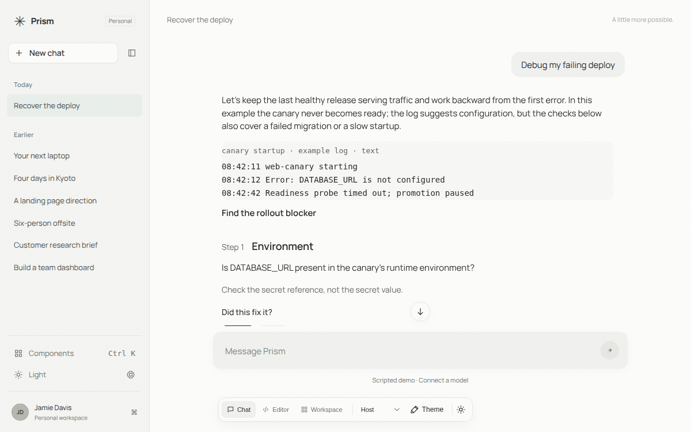
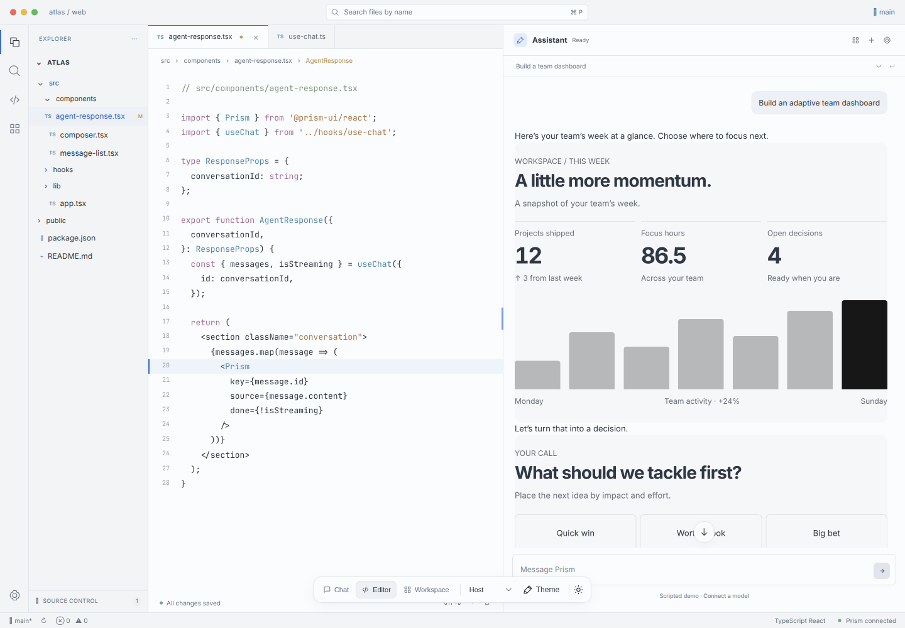
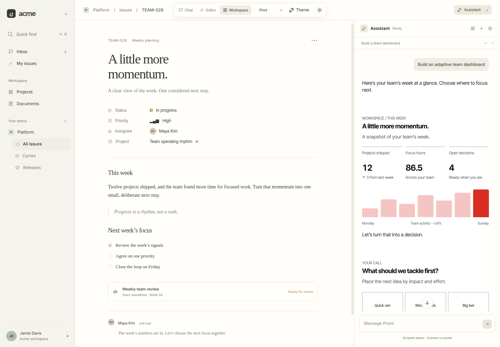
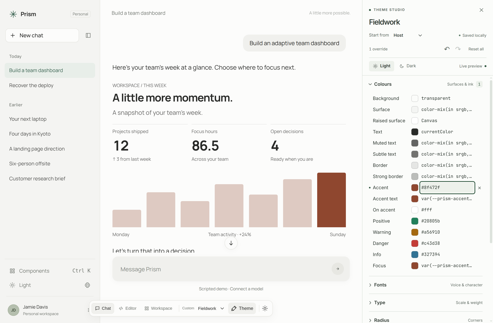

# Prism

**Interactive AI replies, native to your product.** Prism turns streamed Markdown
into stateful components and bespoke inline artifacts that inherit your host's
theme—without owning your model, chat shell or backend.



## A 30-second start

```sh
bun add react react-dom @prism-ui/react @prism-ui/components @prism-ui/state
```

```tsx
import { useState } from 'react';
import { Prism, type Action } from '@prism-ui/react';
import { createStore } from '@prism-ui/state';
import { artifactPlugin } from '@prism-ui/components';
import '@prism-ui/components/styles.css';

const plugins = [artifactPlugin];
export function Reply({ text, streaming, onAction }: {
  text: string; streaming: boolean; onAction(action: Action): void;
}) {
  const [store] = useState(() => createStore());
  return <Prism source={text} done={!streaming} store={store}
    scope="reply-1" plugins={plugins} onAction={onAction} />;
}
```

Append incoming text to `text`; keep this component mounted. For multiple replies,
lift the store into the conversation and give each reply its message ID as scope.
Component-package imports register built-ins; native artifact fences need the
plugin. Generate model instructions with `createSystemPrompt`, and send actions
back as user data with `actionToMessage`.

**[Drop-in integration guides →](docs/INTEGRATION.md)** — Vercel AI SDK v5,
OpenAI, Anthropic, chat apps, narrow panels and shadcn/Tailwind hosts.

## Your shell. Your theme.

| An IDE assistant with an inline artifact | A workspace with a print-inspired theme |
|---|---|
|  |  |



These are the playground's host shells, not mandatory Prism UI. Replace the
entire surrounding product and keep the same model output and conversation store.

## What you get

- **Streaming Markdown + components:** incremental parsing, accessible built-ins,
  custom registries and per-component overrides.
- **Bespoke inline artifacts:** sandboxed HTML, React, SVG, JS or Markdown with
  host tokens, responsive container layouts and capability-granted state.
- **One conversation state:** subscriptions, scoped undo/redo, persistence
  adapters and agent-authored patches.
- **Host control:** semantic tokens, light/dark modes, density, fonts, motion,
  slots, strings, icons, renderers and completely unstyled surfaces.
- **Provider independence:** cumulative strings or text async iterables; no
  required model SDK, backend or shell.
- **A model round-trip:** structured actions, prompt generation and automatic
  `ui:state` patches.

## Learn more

- [Integration](docs/INTEGRATION.md) — working provider and product patterns.
- [Prompting](docs/PROMPTING.md) — generated instructions and example outputs.
- [Theming](docs/THEMING.md) — tokens, slots and host adapters.
- [Artifacts and renderers](docs/RENDERERS.md) — custom interfaces and frame policy.
- [React API](packages/react/README.md) · [Playground](apps/playground/README.md).

## Packages

| Package | Purpose |
|---|---|
| `@prism-ui/react` | Prism, registry, themes, hooks, prompts and actions |
| `@prism-ui/components` | Built-ins, shared styles and inline artifact runtime |
| `@prism-ui/state` | Reactive store, patches, formulas, undo and persistence |
| `@prism-ui/core` | Incremental Markdown/directive parser |
| `@prism-ui/schema` | Component schemas and catalogue generation |
| `@prism-ui/themes` | Optional preset themes |

## Run locally

```sh
bun install
bun run dev
bun test
bunx tsc --noEmit
bun run --cwd apps/playground build
```

The playground starts on port 5173. Its scripted agent works without credentials.
For real models, production apps should keep provider keys on their own server.
